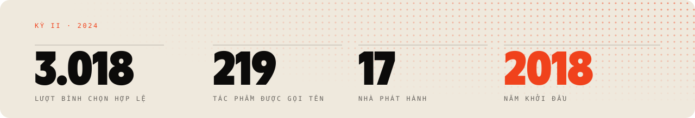

  

  <em>Nơi sức sáng tạo của tác giả gặp gỡ đam mê của độc giả.</em>

  <a href="https://bxh.lightnovel.vn"><strong>bxh.lightnovel.vn</strong></a>
  &nbsp;·&nbsp;
  <a href="https://bxh.lightnovel.vn/leaderboard">Bảng tổng sắp</a>
  &nbsp;·&nbsp;
  <a href="https://bxh.lightnovel.vn/feedback">Góp ý của độc giả</a>
  &nbsp;·&nbsp;
  <a href="https://www.facebook.com/vnlnr">Facebook</a>

 

## Về bảng xếp hạng

**Bảng Xếp Hạng Light Novel Việt Nam** là cuộc bình chọn do chính độc giả Việt Nam cầm phiếu. Mỗi kỳ, cộng đồng cùng gọi tên những tác phẩm và nhà phát hành được yêu thích nhất.

Không chỉ là một cuộc bình chọn, đây là nơi những người yêu Light Novel hội tụ: để giao lưu, chia sẻ và cùng nhìn lại thị trường qua từng kỳ. Ban tổ chức khởi động hành trình này từ năm 2018, với mong muốn xây dựng một bảng xếp hạng công bằng, nơi mọi tác phẩm và mọi góp ý của độc giả đều được lắng nghe.

 

  

 

## Bốn hạng mục

| | Hạng mục | Quán quân kỳ II · 2024 |
| :-: | --- | --- |
| **01** | **Light Novel được yêu thích nhất** Ngôi đền văn học, nơi những xúc cảm tuyệt vời nhất thăng hoa. | Arya Bàn Bên Thỉnh Thoảng Lại Trêu Ghẹo Tôi Bằng Tiếng Nga |
| **02** | **Oneshot được yêu thích nhất** Những tác phẩm chỉ cần một tập để chinh phục trái tim độc giả. | Đường hầm tới mùa hạ - Lối thoát của Biệt ly |
| **03** | **Light Novel tân binh của năm** Ngọn gió mới, những gương mặt vừa đặt bước chân đầu tiên vào thị trường. | Chung Một Mái Nhà |
| **04** | **Nhà phát hành được yêu thích nhất** Những người giữ lửa cho cộng đồng Light Novel nước nhà. | Wingsbooks (Kim Đồng) |

## Trên trang có gì

- **[Trang chủ](https://bxh.lightnovel.vn)**: Top 10 của kỳ mới nhất, quán quân từng hạng mục và hành trình của kỳ bình chọn.
- **[Bảng tổng sắp](https://bxh.lightnovel.vn/leaderboard)**: kết quả đầy đủ của từng kỳ, kèm chân dung những người đã bỏ phiếu.
- **[Góp ý của độc giả](https://bxh.lightnovel.vn/feedback)**: bức tường lời nhắn gửi tới tác phẩm, nhà phát hành và ban tổ chức.
- **[Bình chọn](https://bxh.lightnovel.vn/vote)**: lá phiếu của bạn, mở trong thời gian diễn ra mỗi kỳ.

## Thực hiện

Ban tổ chức **Hyddyt** · phát triển **Zennomi** và **Meoki**.

Cảm ơn mọi lá phiếu, mọi lời góp ý, mọi cuốn sách đã được gọi tên.

  © 2018 - nay · BXH LNVN · おわり

